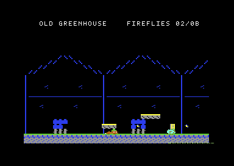

# Whisker Beacon

Pip the cat crosses a twilight garden, dodges patrol cats, and gathers six
fireflies to relight the hilltop beacon. The game has one scrolling level
and the original three-voice SID tune *Lantern Paws*.

[](dist/gameplay.gif)

## Play

Open [whisker-beacon.prg](dist/whisker-beacon.prg) in VICE, or attach
[whisker-beacon.d64](dist/whisker-beacon.d64) to drive 8 on a Commodore 64.
From BASIC on a C64, enter `LOAD"*",8,1` and then `RUN`.

| Action | Keyboard | Joystick in port 2 |
| --- | --- | --- |
| Move | A / D | Left / right |
| Short hop | Tap Space | Tap Fire |
| Full leap | Hold Space | Hold Fire |
| Replay after lighting the beacon | Space | Fire |

Collect at least six fireflies and reach the lantern at the far right. Falling
or touching a patrol cat returns Pip to the latest checkpoint. You keep the
fireflies you collected.

The finish screen shows your time, firefly count, and falls. Finish without
a fall for a clean clear. Press Fire or Space to try for a faster time.
Your best time lasts until you reset the game in the emulator or on the C64.

Watch for a mushroom that launches Pip onto the rooftop route. The blue
firefly earns a star beside the firefly counter.

## Build and test

Install Node.js and 64tass, then run `node build.cjs` from the checkout.
Set `TASS64` to an explicit assembler path if it is outside your PATH.

```sh
node build.cjs
x64sc -autostartprgmode 1 -autostart build/whisker-beacon.prg
```

Run `node build.cjs --disk` to also create the D64 using VICE's `c1541`.
Run `node tests/playtest.cjs` after building to replay the main route on PAL
and NTSC. Run `node tests/jumps.cjs` to check both jump heights, early and late
jump presses, and the blue firefly. `VICE_BIN` selects the emulator executable.
Headless Linux uses `xvfb-run`.

The VICE playtest checks the 50 Hz gameplay and music clocks, both checkpoints,
the finish time and session best, replay, and recovery from a fall. It supplies input at
the game's control-sampling boundary. The screen scroll and sprite positions
update on the native video clock.

The VICE monitor helper was adapted from Luis Lobo's
[C64 demo kit](https://github.com/luislobo/c64-demo-kit). The characters, art,
level, and score were made for Whisker Beacon.
