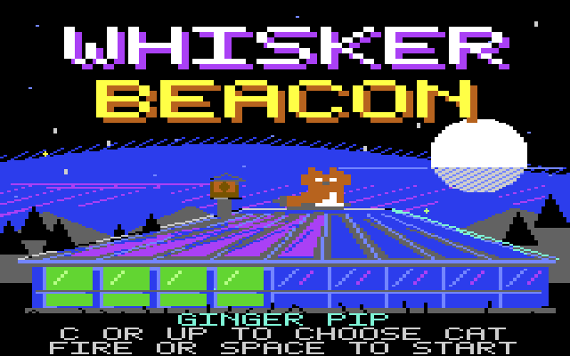
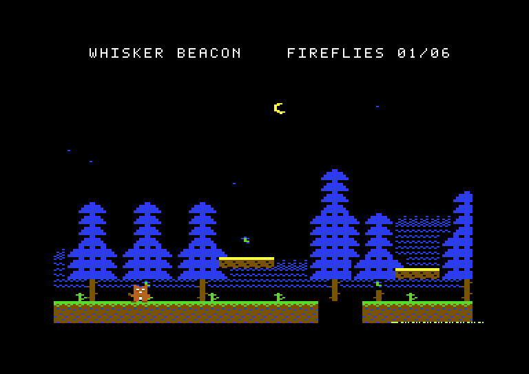

# Whisker Beacon

Pip the cat crosses the twilight garden and the Old Greenhouse. Gather 24
fireflies in each level to relight its beacon. The game uses the original
three-voice SID tune *Lantern Paws*.



[Watch the Rain Gallery in VICE](dist/gameplay.gif) · [Watch all ten cats in motion](dist/cat-sprite-showcase.gif)

## Play

On 64-bit Windows, run this from the cloned repository in PowerShell.

```powershell
powershell.exe -NoProfile -ExecutionPolicy Bypass -File .\run.ps1
```

The launcher opens the included game in VICE. It reuses `x64sc.exe` on
your PATH or downloads VICE under `%LOCALAPPDATA%\WhiskerBeacon` on the
first run. To select a VICE installation in another folder, set
`$env:VICE_BIN` to the full path to `x64sc.exe`.

Open [whisker-beacon.prg](dist/whisker-beacon.prg) in VICE, or attach
[whisker-beacon.d64](dist/whisker-beacon.d64) to drive 8 on a Commodore 64.
From BASIC on a C64, enter `LOAD"*",8,1` and then `RUN`.
Press C or Up on the title screen to preview a cat on the greenhouse roof.
Press Space or Fire to take that cat into the Garden. The SID intro plays once.
Rain ripples across the sloped roof, with smaller droplets near the ridge.

| Action | Keyboard | Joystick in port 2 |
| --- | --- | --- |
| Change cat on the title screen or before moving | C | Up |
| Change charm before moving | V | Down |
| Move | A / D | Left / right |
| Short hop | Tap Space | Tap Fire |
| Full leap | Hold Space | Hold Fire |
| Slide | Hold A or D, then press S | Hold left or right, then press Down |
| Replay after lighting the beacon | Space | Fire |
| Enter the greenhouse after clearing the garden | D and Space | Right and Fire |
| Return to the garden after clearing the greenhouse | A and Space | Left and Fire |

Use the wardrobe at the start of either level. The cats share the same
movement and collision rules. Finish either level without a fall to unlock
Tuxedo. A rare Garden firefly earns the cyan ribbon. A firefly from a
Greenhouse lantern cache earns the brass bell. It folds close to the cat
during slides. Rewards stay unlocked until you reload the game.

When you pause near a rare firefly you have yet to collect, watch Pip's ears
and tail for a clue.

Collect at least 24 gold fireflies, then reach the beacon between the gold
arrows at the far right. Falls and enemy hits return Pip to the latest
checkpoint. You keep the fireflies you collected. A gold arrow marks each
new section and its checkpoint.

The Garden crosses a moonlit stream, an orchard, an aqueduct, a mushroom
dell, and the beacon terraces. The Old Greenhouse adds propagation racks,
the Rain Gallery, a shade house, a seed vault, and an observatory.

In one stretch of the Rain Gallery, the sunset moves at a quarter of the
floor's speed and the trees move at half speed. Pip runs inside, past
lantern-lit platforms and greenhouse window frames. Sliding across the
gallery floor kicks up a short spray.



Slide under low shelves, scatter dust mites, and turn rolling acorns around.
Release Down or S between slides. You can slide again after a short recovery.
The silver bell opens a shortcut gate. Touch a greenhouse lantern to reveal
bonus fireflies. Watch for the owl's shadow before it swoops, and stay low
when a moth dips into your path.

The finish screen shows your time, firefly count, and falls. Finish without
a fall for a clean clear. Press Fire or Space to try for a faster time.
Each level keeps its own best time until you reload the game.

Look for mushrooms and stepped ledges that lead to high routes. A cyan
firefly earns a star beside the firefly counter.

## Build and test

Install Node.js and 64tass, then run `node build.cjs` from the checkout.
Set `TASS64` to an explicit assembler path if it is outside your PATH.

```sh
node build.cjs
x64sc -autostartprgmode 1 -autostart build/whisker-beacon.prg
```

Run `node build.cjs --disk` to also create the D64 using VICE's `c1541`.
Run `node tests/campaign.cjs` to clear both levels on PAL and NTSC. The clean
test routes take 58.10 seconds in the Garden and 58.20 in the Old Greenhouse.

Run `node tests/playtest.cjs` to check the Garden opening.
Run `node tests/greenhouse.cjs` to check the greenhouse hazards and lanterns.
Run `node tests/jumps.cjs` to test jump timing and the first cyan firefly.
Run `node tests/wardrobe.cjs` to check the wardrobe and movement poses.
Run `node tests/title.cjs` for the title, SID cue, and start controls.
Run `node tests/wet-glass.cjs` to check the roof animation on PAL and NTSC.
Run `node tests/brass.cjs` for the bell's pickup glint and slide animation.
Run `node tests/scroll.cjs` to check the camera in both directions across a
map page boundary.
Run `node tests/parallax.cjs` to check the scroll speeds and palette changes
at the Rain Gallery windows on PAL and NTSC.
Set `VICE_BIN` to select the emulator. Headless Linux uses `xvfb-run`.

The camera updates at 50 FPS on PAL and 60 FPS on NTSC. Gameplay and music
advance at 50 Hz in both modes. The title and gameplay GIFs were captured
in PAL VICE. The gameplay GIF samples every other frame.

The VICE monitor helper was adapted from Luis Lobo's
[C64 demo kit](https://github.com/luislobo/c64-demo-kit). The characters, art,
levels, and score were made for Whisker Beacon.

Linus Åkesson's bump-mapped rain in *Lunatico* inspired the roof effect.
[Rain Effect Explained](https://www.linusakesson.net/scene/lunatico/rain.php)
